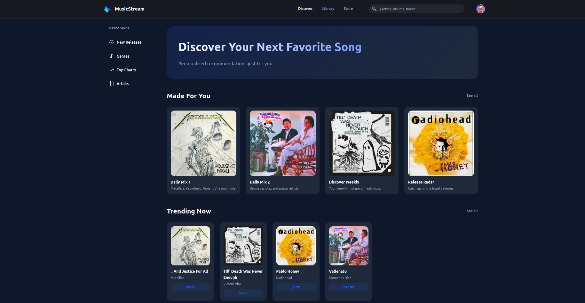
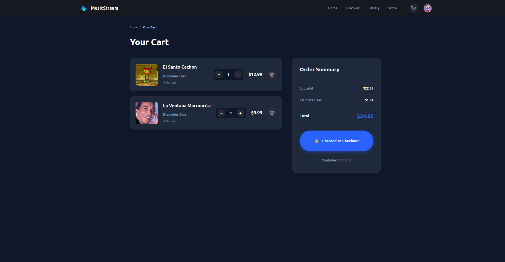
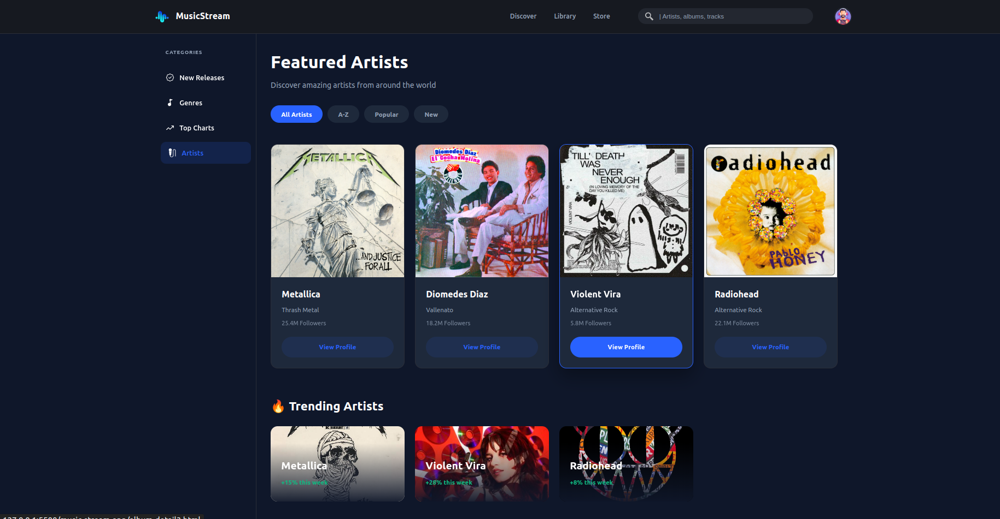
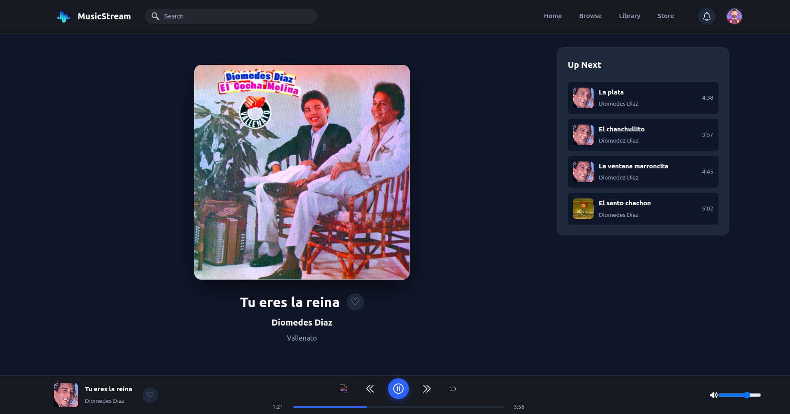

# 🎵 MusicStream — Plataforma Web de Streaming Musical & E-Commerce

<div align="center">

[](https://sergioandresaparicio.github.io/Music-stream-app/)
[](https://developer.mozilla.org/en-US/docs/Web/HTML)
[](https://developer.mozilla.org/en-US/docs/Web/CSS)
[](https://developer.mozilla.org/en-US/docs/Learn/CSS/CSS_layout)
[](LICENSE)

**Maqueta interactiva de alta fidelidad que simula la experiencia completa de reproducción, navegación y compra de música digital en la web.**

[🌐 Ver Demo en Vivo](https://sergioandresaparicio.github.io/Music-stream-app/) • [📦 Repositorio](https://github.com/Sergioandresaparicio/Music-stream-app) • [🐛 Reportar Bug](https://github.com/Sergioandresaparicio/Music-stream-app/issues)

</div>

---

## 📖 Descripción del Proyecto

**MusicStream** es una plataforma web frontend diseñada para ofrecer una experiencia inmersiva de exploración musical y comercio electrónico. Desarrollada como parte de los proyectos de maquetación avanzada en **Campuslands**, la aplicación cuenta con más de **15 vistas interconectadas** que simulan el flujo completo de una aplicación de streaming moderna tipo Spotify o Bandcamp.

### 🎯 Objetivos de Ingeniería y Diseño:
* **Maquetación Modular:** Estilos organizados mediante arquitectura por componentes y vistas (`CSS/views/`).
* **Sistemas de Diseño con CSS Custom Properties:** Centralización de paletas de color oscuro (Dark Mode), tipografías, transiciones y espaciados mediante variables nativas de CSS.
* **Layouts Fluidos y Flexibles:** Uso intensivo y combinado de **CSS Grid** (catálogos, galerías de álbumes) y **Flexbox** (barras de navegación, controles del reproductor, listas de reproducción).
* **Interacciones Avanzadas sin Dependencias:** Pestañas dinámicas (About/Reviews/Credits) y controles interactivos implementados con técnicas modernas de CSS puro (checkbox / radio hack y transiciones fluidas).

---

## 📸 Vitrina Visual (Capturas de la Interfaz)

| Descubrimiento & Catálogo | Carrito & Checkout |
|:---:|:---:|
|  |  |
| **Exploración de Artistas** | **Reproductor en Pantalla Completa** |
|  |  |

---

## ✨ Características y Vistas Principales

* 🎧 **Reproductor de Música Fijo:** Barra de control inferior con progreso de pista, volumen, carátula y botones de control.
* 🧭 **Navegación Integral Multi-página:**
  * `index.html`: Portada principal y tienda digital destacada.
  * `discover.html`: Recomendaciones y radar de novedades.
  * `artists.html` / `artist-profile.html`: Catálogo y biografía de artistas.
  * `genres.html`: Exploración temática por géneros musicales.
  * `album-detail[1-4].html`: Vistas detalladas de álbumes con listas de tracks y precios.
  * `cart.html` / `checkout.html` / `success.html`: Flujo completo de compra simulada (carrito, pasarela y comprobante).
  * `top-charts.html`: Tablas de popularidad y tendencias.
  * `library.html`: Colección y biblioteca personal.
* 📱 **Diseño Totalmente Responsivo:** Adaptación precisa a pantallas móviles, tabletas y monitores de alta resolución.

---

## 📂 Estructura del Proyecto

```text
Music-stream-app/
├── index.html                   # Página principal de bienvenida y tienda
├── discover.html                # Explorador de recomendaciones
├── library.html                 # Biblioteca de usuario
├── store.html                   # Catálogo de venta de álbumes
├── cart.html                    # Carrito de compras
├── checkout.html                # Formulario de pago simulado
├── success.html                 # Pantalla de confirmación de pedido
├── genres.html                  # Filtrado por géneros musicales
├── new-releases.html            # Lanzamientos recientes
├── top-charts.html              # Listas de éxitos y tendencias
├── artist-profile.html          # Perfil de artista
├── artists.html                 # Catálogo global de artistas
├── album-detail[1-4].html       # Páginas de detalle de álbumes
├── player[1-4].html             # Vistas del reproductor
├── playlist-create.html         # Creación de listas de reproducción
├── settings.html                # Panel de configuración de usuario
├── README.md                    # Documentación técnica
├── LICENSE                      # Licencia de código abierto MIT
├── .gitignore                   # Exclusiones de control de versiones
│
├── CSS/
│   ├── main.css                 # Variables globales, reset y estilos base
│   └── views/                   # Hojas de estilo modulares por vista
│       ├── album.css
│       ├── artists.css
│       ├── cart.css
│       ├── checkout.css
│       ├── discover.css
│       ├── genres.css
│       ├── library.css
│       ├── new-releases.css
│       ├── player.css
│       ├── store.css
│       └── top-charts.css
│
└── assets/
    ├── icons/                   # Iconografía vectorial SVG optimizada
    ├── img/                     # Carátulas de álbumes y avatares
    └── capturas/                # Evidencias visuales de la interfaz
```

---

## 🚀 Despliegue y Ejecución Local

### Demo en Producción
La aplicación se encuentra desplegada y disponible para consulta directa en:
👉 **[https://sergioandresaparicio.github.io/Music-stream-app/](https://sergioandresaparicio.github.io/Music-stream-app/)**

### Ejecución Local
```bash
# 1. Clonar el repositorio
git clone https://github.com/Sergioandresaparicio/Music-stream-app.git

# 2. Navegar al directorio
cd Music-stream-app

# 3. Abrir index.html en el navegador
# En Windows (PowerShell):
Start-Process index.html

# O utilizando Live Server en VS Code:
code .
```

---

## 🔄 Buenas Prácticas de Control de Versiones

* **Conventional Commits:** Historial de cambios estandarizado con formato semántico (`feat:`, `fix:`, `docs:`, `style:`, `refactor:`).
* **Gestión de Ramas (Gitflow):**
  * `main`: Código verificado y estable en producción.
  * `develop`: Integración y desarrollo activo.
  * `gh-pages`: Despliegue automatizado del cliente web.
* **Control de Versiones Semántico (SemVer):** Tag de lanzamiento oficial `v1.0.0`.

---

## 👥 Equipo de Desarrollo

* **Sergio Andrés Aparicio Galvis** — *Desarrollador Frontend* — [@Sergioandresaparicio](https://github.com/Sergioandresaparicio)
* **Sebastian Ayala** — *Desarrollador Frontend*
* **Brayan Fonseca** — *Desarrollador Frontend*

---

## 📄 Licencia

Este proyecto se encuentra bajo la Licencia **MIT**. Consulta el archivo [LICENSE](LICENSE) para mayores detalles.
